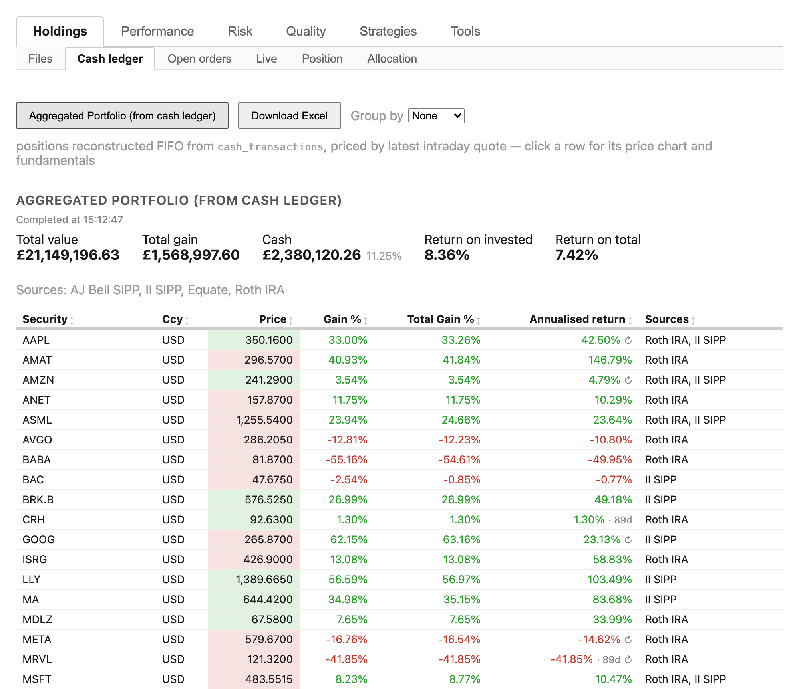
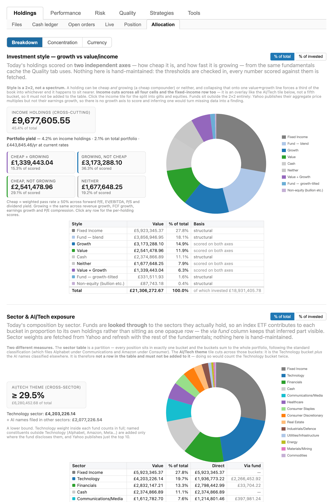
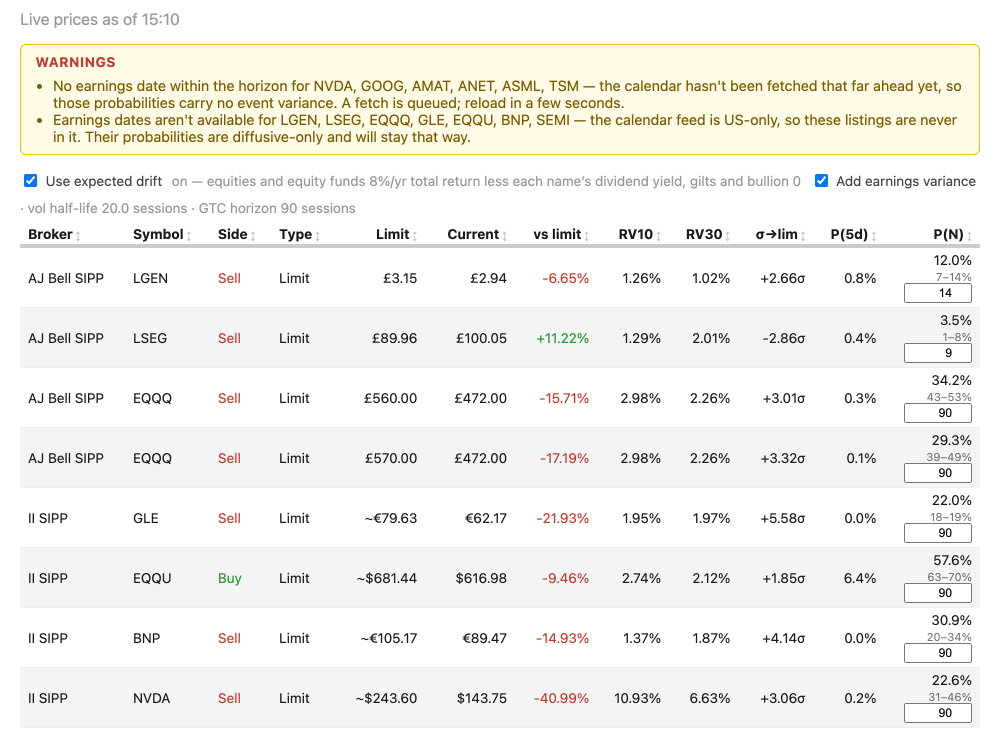
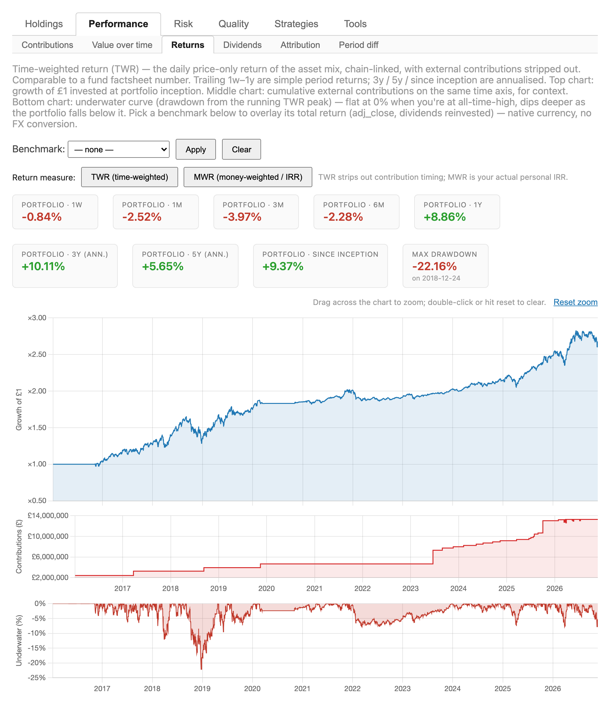
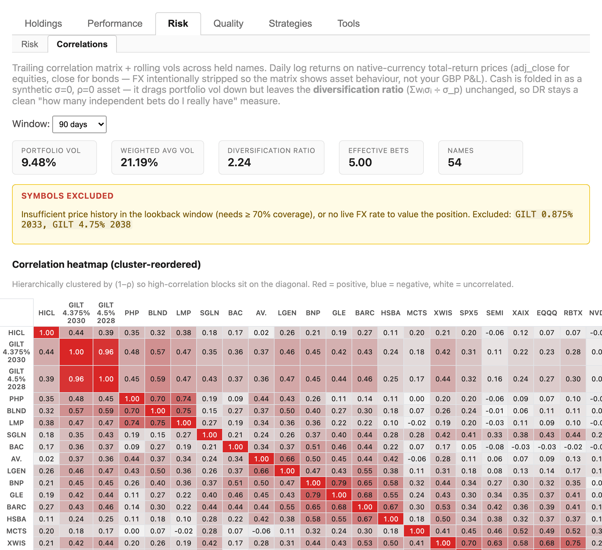
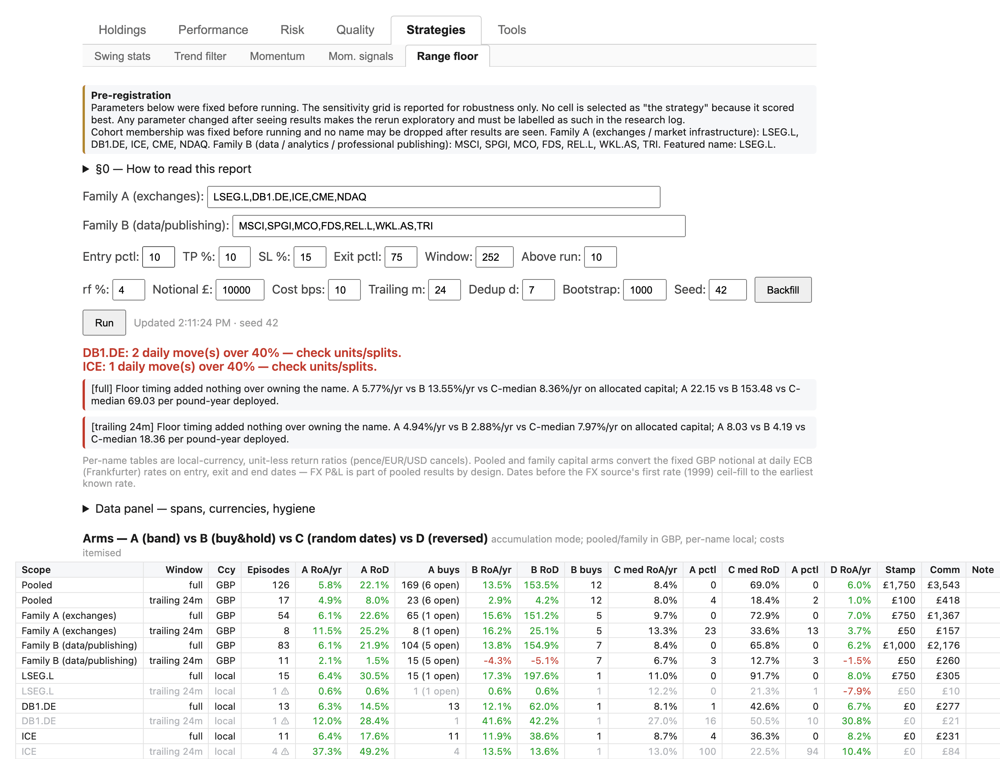
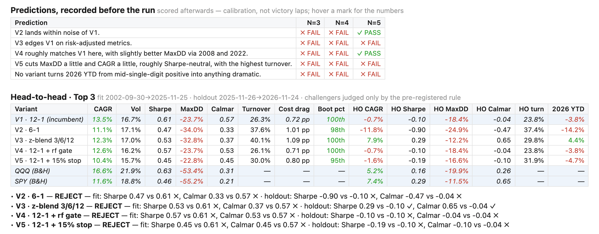
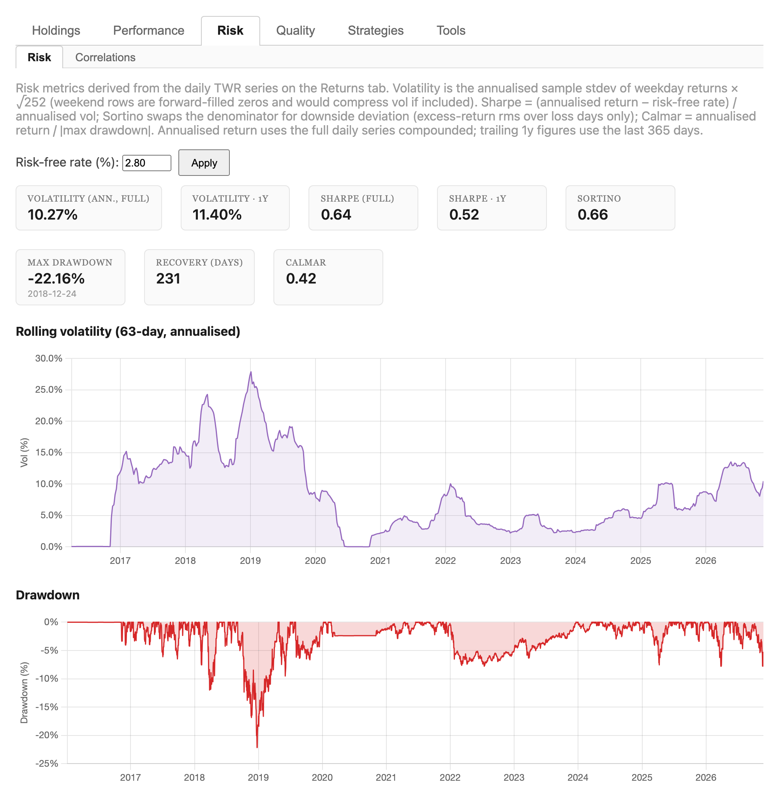
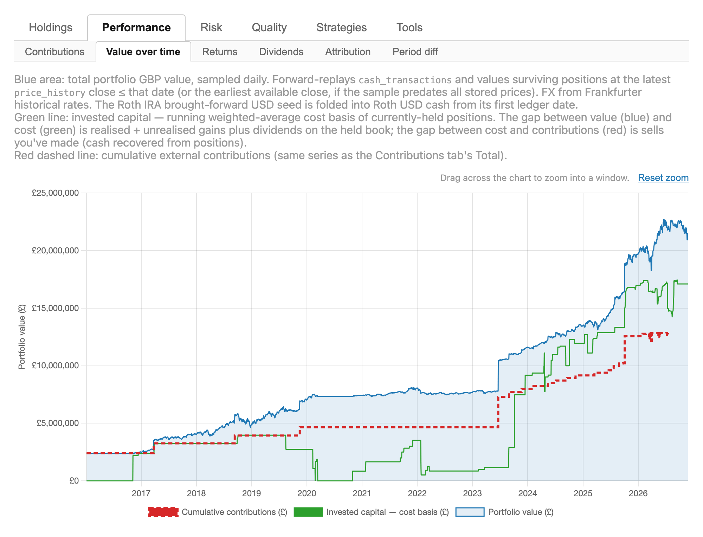
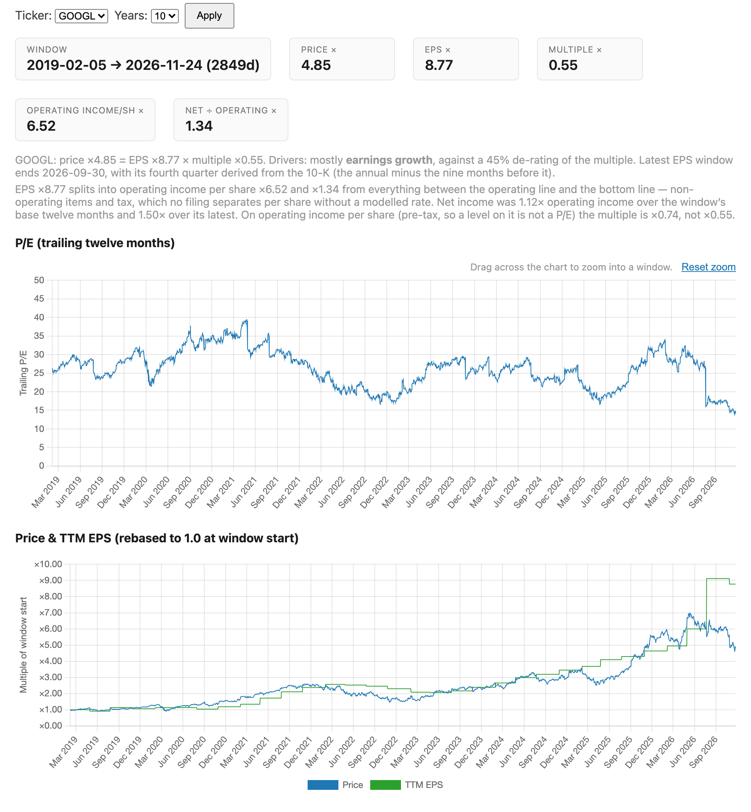

# Portfolio Bench

A local-first portfolio analytics workbench. It brings one person's investments — four accounts at
three brokers, in the UK and the US — into a single ledger, values them against live market data,
and analyses returns, risk and allocation. It also runs pre-registered backtests that are built to
be able to answer "no, this doesn't work", and that say so prominently when it doesn't.

**Java 25 · Spring Boot 3.5 · SQLite · Thymeleaf + htmx + Chart.js** — built solo, with Claude as an
AI pair programmer.


<sub>Holdings rebuilt FIFO from every account's cash ledger and priced live, with gain and an IRR-based
annualised return per position and the accounts each one is held in. All screenshots come from the
app's demo mode — sample data, not a real portfolio — with the position-size columns hidden.</sub>

## At a glance

- **29 analytics tabs** in six groups — Holdings, Performance, Risk, Quality, Strategies, Tools.
- **~54k lines of Java** across 281 files, covered by **2,437 JUnit tests** plus 98 JavaScript unit
  tests. Coverage has a per-package floor that is never lowered.
- **Architecture enforced by the build.** Ports-and-adapters layering is checked by ArchUnit on
  every `mvn test`, and Spring is confined to the web and wiring layers.
- **Nine broker export formats** (CSV and Excel) parsed and deduplicated, plus six market-data
  sources — Yahoo Finance, Frankfurter (ECB FX), SEC EDGAR, Nasdaq, Hargreaves Lansdown, Tradeweb.
- **No frontend build chain.** htmx and Chart.js are vendored and pinned; ~14k lines of
  hand-written JavaScript.
- **Read-only toward the brokers.** It reconciles, values and analyses; it never places an order.

## What it does

### Holdings

Two independent valuation pipelines run side by side: one from the brokers' holdings files, one
replayed from the cash ledger. Where they disagree, something is wrong — that comparison has caught
most of the reconciliation defects on record. The ledger side rebuilds every position FIFO,
attributes each dividend back to the lots that earned it, and replays in-specie transfers between
accounts. Around it sit a live price tab streamed over server-sent events, a per-position
drill-down, and allocation views.


<sub>Investment style scored on two independent axes, cheap × growing. Sectors look through each fund
to what it holds. The AI/Tech figure is an overlay across sectors, kept out of the table so it can't
be double-counted.</sub>

**Open orders** collects resting limit orders from every broker and estimates each one's chance of
filling: a first-passage probability on a volatility forecast for the order's own horizon. Current
20-day realised variance is blended toward a 250-day anchor at a tunable half-life, so a stock fresh
from a violent fortnight isn't priced as if the next quarter will be just as violent; scheduled
earnings add their own jump variance. Laddered orders and share-class switches (selling one listing
of a fund to buy another) are tracked as groups, and a probe tests a limit before it is placed.


<sub>Each order's distance to its limit in σ, and its probability of touching within 5 sessions and
within its own horizon. The caveats come first: which names carry no earnings variance, and why.</sub>

### Performance

Time-weighted and money-weighted (IRR) returns with benchmark overlays; contributions and value over
time replayed from the ledger at historical FX rates; dividend history and audit; per-symbol P&L
attribution over any window; and a period diff that values both ends of a window off the ledger and
keeps *change*, *gain* and *total return* apart.



### Risk

Sharpe, Sortino and Calmar, rolling volatility and drawdown, and a cluster-ordered correlation matrix
with a diversification ratio and an effective-number-of-bets measure — tracked over time, so
correlations converging in a selloff are visible.


<sub>The amber strip is one of the rules below at work: two gilts lack enough price history for the
window, so they are left out of every figure and named — not zero-filled, not silently dropped.</sub>

### Quality

A fundamentals grid with change tracking; a P/E history that splits a stock's price move into
earnings growth and change in multiple, using diluted EPS from SEC XBRL filings; a what-if planner;
and a replay of historical scenarios against substitute instruments.

### Strategies

Five read-only backtests. Each is **pre-registered**: parameters, cohorts and the adoption rule are
fixed before the run and printed with the results, and changing any of them afterwards marks the run
exploratory. Each is measured against controls designed to make it fail — buy-and-hold, a matched
random-timing bootstrap, a placebo or a reversed signal. Signals only see closes strictly before the
bar being judged; trades still open when the data ends are counted as censored, not dropped; and
every variant, control and bootstrap iteration runs through the same accounting code.

- **Swing lab** — short-term mean reversion after volatility "flushes", simulated against intraday
  highs and lows, with earnings windows screened out using SEC filing dates.
- **Trend filter** — moving-average exits on the Nasdaq-100 over 40 years, across five signal
  clocks, with whipsaw costs itemised.
- **Momentum** — cross-sectional 12-1 rotation against random-selection and reversed-signal
  controls.
- **Momentum signals** — five signal variants judged by a pre-registered adoption rule, on a fit
  window and an untouched holdout year.
- **Range floor** — percentile-band entries on two cohorts of stocks, against buy-and-hold, random
  entry dates and a mirrored entry.


<sub>The report opens with its pre-registration and gives the verdict plainly: on these names, timing
entries off the range floor added nothing over simply owning them.</sub>


<sub>Predictions written down before the run and scored after it — most of them failures — and four
challengers rejected by the rule fixed in advance.</sub>

### Tools

Holdings-vs-ledger reconciliation; a trade journal whose notes survive re-imports; watchlists with
alerts that fire on a *crossing*, not on a state the market is sitting in; an earnings calendar that
tells "nothing due" apart from "unknown", and a view of how each print moved the stock in the first
session it could be traded; calendar reminders, emailed once a day; hand-entered positions for
accounts with no export; in-specie transfers; and a monthly off-machine backup of everything that
can't be re-fetched. Six Excel exports recompute their figures when the button is pressed and write
live formulas, not pasted values.

<details>
<summary><b>More screenshots</b> — risk metrics, value over time, P/E history</summary>








</details>

## Rules the code is held to

Most of these exist because of a specific bug, and several are now checked by the build.

- **Absent is never zero.** A missing figure is `null` — "we don't know" — never `0`, "we measured
  zero". Zero-filling a position that couldn't be valued once produced a ~£299k phantom gain in
  attribution; the fix was a rule, not a patch.
- **Excluded, and said so.** Anything that can't be valued or classified is dropped from the rows
  *and every total* and named in the response, which the UI shows as the warning strips in the
  screenshots above.
- **Write paths throw, reads degrade.** A failed save is an error the user sees; a failed feed or
  background insert is logged and returns empty, so an outage can't stop the scheduler.
- **Due-checked, never cron'd.** A background job asks whether its work is owed — "has a price pass
  completed since the last 22:00?" — rather than firing at a clock time. The laptop it runs on is
  asleep at most instants you could name, and a cron job doesn't run for a day it slept through.
- **Self-regulating over maintained.** No hand-kept lookup table where a live source publishes the
  fact: gilt SEDOLs, fund sector weights and SEC company ids are all fetched.

## Harder than it looks

- **Multi-broker dedup.** AJ Bell inserts dividends retroactively mid-statement, shifting every
  later running balance; Interactive Investor back-dates rows and leaves cash out of its holdings
  export; Citi re-partitions partial fills between exports. Each broker has a composite, cross-file
  dedup key, so re-importing yesterday's statement is always a no-op.
- **Two accounts, one broker.** Only the holdings export says which account it belongs to, so cash
  statements and orders are routed by the instruments they mention — and a file that can't be placed
  is reported, never guessed.
- **Gilts.** Three brokers name the same UK government bond three ways, and one names it only by
  SEDOL, which is scraped from a price page already fetched hourly. The canonical id is built in
  exactly one place, because it is a join key.
- **Total-return prices.** `adj_close` is re-derived from the dividend and split streams on every
  fetch, because the feed's own adjusted close is only split-adjusted for many UK listings. A split
  the feed never published is recorded as a ledger row, never patched into the price history.
- **Trailing earnings.** A 10-K rarely tags its own fourth quarter, so trailing-twelve-month EPS is
  assembled from four quarters that must tile a year contiguously, with Q4 derived as the annual
  figure minus the nine months before it.
- **Earnings feeds.** The calendar serves four response shapes, told apart structurally, and flips
  between them from one date to the next; `[]` (a successful empty day) is never confused with
  `null` (a failed read). Surprises are recomputed from estimate and actual, never read from the
  feed.

## Architecture

Ports and adapters, in a single Maven module. `domain` is pure Java with no I/O; `port` holds small
interfaces that tests fake; `adapter` implements them against the outside world; `parser` reads
broker exports; `persistence` owns all JDBC; `application` orchestrates use cases; and only `web`
and `config` know Spring exists.

```
web ──► application ──┬──► domain        pure logic, no I/O
                      ├──► persistence ──► SQLite (plain JDBC, no ORM)
                      ├──► parser ──────► broker CSV / Excel exports
                      └──► port ◄── adapter ──► Yahoo · Frankfurter · EDGAR · Nasdaq · HL · SMTP
```

**Enforced, not aspirational.** `mvn test` fails the build when:

- a dependency runs against the layer table. Six ArchUnit rules cover layer direction, a pure
  `domain`, Spring confined to `web` and `config`, JDBC confined to `persistence`, no console output
  from production code, and no cycles. The 60 known shortcuts from `web` straight into
  `persistence` or `adapter` are frozen in a baseline that can shrink but never grow;
- coverage falls below its JaCoCo floor — 80% of lines overall, up to 94% for the pure-logic
  packages — and a floor is never lowered to let a commit through;
- the index of the design documentation drifts out of shape (next section).

## Built with an AI pair programmer

Built solo, with Claude as the pair programmer: architecture, review and the slicing of each feature
stayed mine, while the AI handled mechanical implementation, test scaffolding and refactors under
direction. Each tab or analytic ships as its own focused commit with tests.

The design notes are written to double as the AI's grounding. [`CLAUDE.md`](CLAUDE.md) is a short
index of the conventions that apply everywhere, plus a routing table into 37 documents under
[`docs/`](docs/) — one per feature area, carrying the reasoning, the evidence and the incidents
behind each invariant. The index is loaded into every session, so its size is a running cost, and it
is under test: `DocsIndexTest` holds it to a character budget checked from both sides (failing if
the file grows past the budget *or* shrinks well below it, so unclaimed headroom can't accumulate),
caps each routing row at 45 words, and fails on any document the index doesn't reach. That came from
experience. The index once grew from 23k to 60k characters in seven weeks, because the cheapest
place to write down a new rule in the moment is the file every session reads.

## Stack

| Layer       | Choice                                                                    |
|-------------|---------------------------------------------------------------------------|
| Language    | Java 25                                                                   |
| Framework   | Spring Boot 3.5, confined to the web and wiring layers                    |
| Persistence | SQLite via plain JDBC, no ORM                                             |
| UI          | Server-rendered Thymeleaf + htmx; Chart.js 4 with zoom — vendored, pinned |
| Excel I/O   | Apache POI                                                                |
| Testing     | JUnit 5, ArchUnit, JaCoCo; Node's built-in test runner for JavaScript     |
| Build       | Maven, single module                                                      |
| Data        | Yahoo Finance, Frankfurter, SEC EDGAR, Nasdaq, Hargreaves Lansdown, Tradeweb |

## Running it

```bash
mvn test                              # unit tests, architecture rules, coverage ratchet
node --test src/test/js/*.test.mjs    # JavaScript unit tests
mvn spring-boot:run                   # then open http://127.0.0.1:8080
```

It is a single-user local tool: it binds to loopback only and has no authentication. It reads broker
exports from `~/Downloads` and keeps its database under `~/Documents/Investing`; override them with
`--portfolio.input-dir=…`, `--portfolio.db-dir=…` and `--portfolio.output-dir=…`. To run it in the
background, `mvn package`, then `scripts/start.sh` and `scripts/stop.sh`.

The screenshots come from a demo mode — the same build pointed at a generated dataset, with its own
port and directories. Its generator profile lives outside this repository, so the demo can't be
rebuilt from a clone. Test fixtures under `src/test/resources/` are synthetic: no real brokerage
export has ever been committed.
