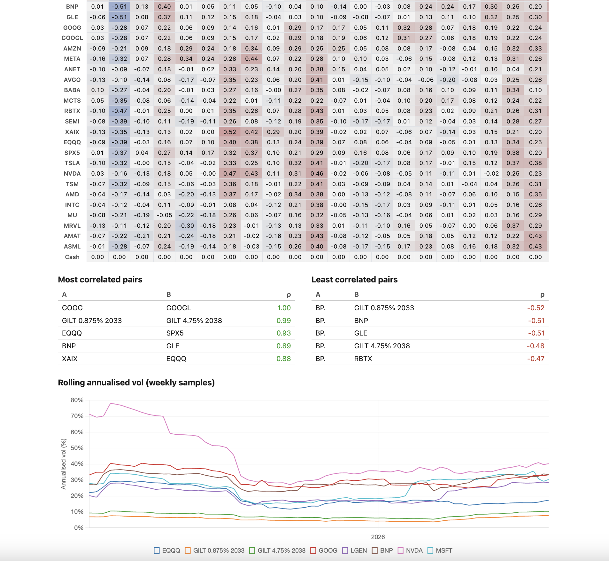
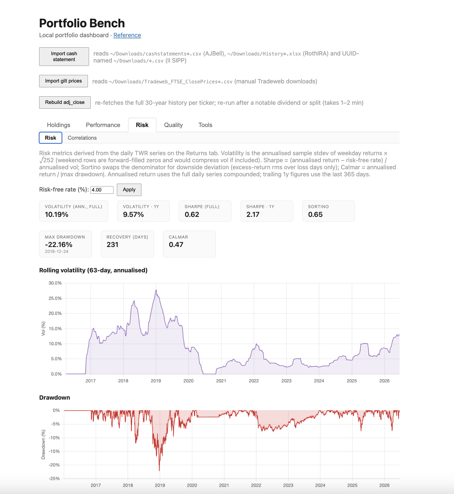

# Portfolio Bench

A local-first portfolio aggregator and analytics dashboard for a multi-broker retirement
portfolio (AJ Bell SIPP, Citi Roth IRA, Interactive Investor SIPP). It parses the broker
exports, reconciles them against intraday Yahoo Finance prices and Frankfurter FX rates,
persists everything to SQLite, and renders 28 analytics tabs through a server-rendered
Thymeleaf + htmx + Chart.js UI.

## Screenshots




## TL;DR

Java 25 / Spring Boot 3.5. ~42 kLOC main + ~21 kLOC test, **1,000+ unit tests**, clean
ports-and-adapters layering with Spring confined to `web` + `config`. SQLite via JDBC (no ORM),
Apache POI for Excel I/O, no frontend build pipeline — every JS dependency is vendored and
pinned. Single Maven module. Built solo with Claude as an AI pair programmer.

## What it does

Tabs are grouped six ways. Everything below is read-only with respect to the brokers — the tool
reconciles, values and analyses, and never places an order.

**Holdings.** Two independent valuation pipelines that must agree: one from the downloaded
holdings files, one replayed from the cash ledger. Disagreement between them is the bug-detector
that has caught most of the reconciliation defects on record. Plus a live SSE price tab, a
per-position drill-down, allocation charts, and **open orders** — resting limits across all three
brokers with a first-passage touch probability priced on a horizon-matched volatility forecast
(mean-reverting σ blend, optional drift netted per-name against its own dividend yield, optional
scheduled-earnings variance), an editable per-row horizon, and a pre-trade limit probe.

**Performance.** Contributions, value over time, TWR and money-weighted (IRR) returns with
benchmarks, dividend history and audit, per-symbol P&L attribution over any window, and a
period-diff that values both boundaries off the ledger and separates *change* from *gain* from
*total return*.

**Risk.** Sharpe / Sortino / Calmar, max drawdown with an underwater chart, and a correlation
matrix with a diversification-ratio-over-time line that visualises correlation contagion during
selloffs.

**Quality.** A fundamentals snapshot with diffing, a what-if planner, and historical-scenario
replay against substitutable instruments.

**Strategies.** Five pre-registered, read-only backtests, each built to be able to return "no,
this doesn't work" and to say so prominently: a short-term mean-reversion **swing** lab
(OHLC triple-barrier simulation, all-days placebo and matched-random bootstrap controls,
absolute and σ-scaled trigger families, earnings-window hygiene from SEC EDGAR filing dates); a
moving-average **trend filter** across five signal clocks with whipsaw accounting; cross-sectional
12-1 **momentum** rotation against random-selection and reversed-signal controls; a five-variant
**signal-speed comparison** judged by a pre-registered adoption rule with a contamination
disclosure; and a percentile **range floor** strategy scored against buy-and-hold, a seeded
bootstrap and a mirrored-entry sanity check.

**Tools.** Holdings-vs-ledger reconciliation, a trade journal keyed by SQLite `rowid` so notes
survive re-imports, a volatility-trading watchlist with emailing alert triggers, a forward-looking
earnings calendar, hand-entered positions for accounts with no export, and in-specie transfer
recording.

Four **Excel exports** (aggregated portfolio, cash ledger, live positions, open orders) write
date-stamped workbooks with live formulas rather than baked values.

## Under the hood

A few things that were harder than they look:

- **Multi-broker dedup.** Each broker has its own export quirks — AJ Bell retroactively inserts
  dividends mid-file and shifts every later balance; II back-dates rows and omits cash from its
  holdings export; Citi re-partitions partial fills between exports and needs a brought-forward
  USD seed. Each gets a composite, cross-file dedup key, so re-importing yesterday's statement is
  always a no-op.
- **FIFO lot accounting** rebuilt from the cash ledger, with dividends attributed back to the lots
  that earned them in native currency at the ex-date.
- **Gilts.** Three brokers name the same gilt three different ways and one names it not at all —
  the cash statement identifies it only by SEDOL, which is scraped for free from a price page
  already fetched hourly. The canonical id is built in exactly one place because it's a join key.
- **Total-return prices.** `adj_close` is re-derived from the dividend and split streams on every
  fetch, because Yahoo's bundled value is only split-adjusted for many UK listings.

## Architecture

Ports and adapters. `domain` is pure Java. `port` defines small SPIs (`FxRateProvider`,
`HistoricalFxRateProvider`, `EarningsCalendarProvider`, `EarningsCalendarFeed`, `AlertNotifier`).
`adapter` implements them against Yahoo Finance, Frankfurter, Hargreaves Lansdown (gilt prices),
Tradeweb (gilt close imports), Nasdaq (earnings calendar) and SEC EDGAR (filing dates).
`application` orchestrates use cases. `persistence` owns all JDBC. `web` and `config` are the only
Spring-aware layers.

```
web ──► application ──► domain
        │            ▲
        ├► port ◄── adapter (Yahoo, Frankfurter, HL, Nasdaq, EDGAR)
        └► persistence (SQLite)
```

Design notes live in [`CLAUDE.md`](CLAUDE.md) — cross-cutting conventions and a routing index —
and in [`docs/`](docs/), one file per feature area carrying the reasoning behind it. Together they
are the architecture document, and they double as the grounding for the AI pair programmer.

## Stack

| Layer         | Choice                                                         |
|---------------|----------------------------------------------------------------|
| Language      | Java 25                                                        |
| Framework     | Spring Boot 3.5 (web layer only)                               |
| Persistence   | SQLite via JDBC, no ORM                                        |
| Excel I/O     | Apache POI                                                     |
| Templating    | Thymeleaf + htmx                                               |
| Charts        | Chart.js 4 (+ date-fns adapter, zoom plugin, hammer.js)        |
| Frontend deps | Vendored and pinned by exact URL — no CDN, no build chain      |
| Build         | Maven                                                          |
| External APIs | Yahoo Finance, Frankfurter (FX), Hargreaves Lansdown, Nasdaq, SEC EDGAR |

## Quality signals

- **1,000+ unit tests** across 135 classes covering parsers, dedup, FIFO, dividend attribution,
  FX, returns, correlations, concentration, the four backtest engines, the volatility/touch model,
  service-layer valuation and repository reads — plus JS unit tests under `src/test/js/`.
  Live-API tests are tagged `@Tag("integration")` and excluded from default runs; Yahoo, Nasdaq
  and EDGAR parsing are covered by captured JSON fixtures.
- All fixtures under `src/test/resources/` are **synthetic** — no real brokerage export has ever
  been committed.
- Write paths throw `IllegalStateException` and surface as a friendly error fragment; read paths
  and background-job inserts log and degrade, so a feed outage can never crash the scheduler.
- Anything that can't be valued or classified is **excluded from every total and named in the
  payload**, never absorbed silently — the UI renders it as a warning strip.
- Per-broker dedup is idempotent and tested; re-importing the same cash statement is a no-op.

## Run locally

```bash
mvn spring-boot:run                  # foreground
scripts/start.sh / scripts/stop.sh   # daemon, log under ~/log/portfolio-bench.log
mvn test                             # unit tests (integration excluded by default)
node --test src/test/js/*.test.mjs   # JS unit tests
```

Then open <http://127.0.0.1:8080>. The server binds to loopback only — there's no auth, it's a
single-user local tool. Directories are overridable via `--portfolio.input-dir=…`,
`--portfolio.db-dir=…`, `--portfolio.output-dir=…`.

Note that `start.sh` runs a prebuilt jar and does not rebuild — run `mvn package` first.

## Development notes

Built solo with Claude as an AI pair programmer: architecture, review and per-feature slicing
remained mine; the AI handled mechanical implementation, test scaffolding and refactors under
direction. The commit history reflects the cadence — each tab or analytic ships as its own
focused commit with tests, and `CLAUDE.md` plus `docs/` codify the invariants the AI must respect
across sessions.
